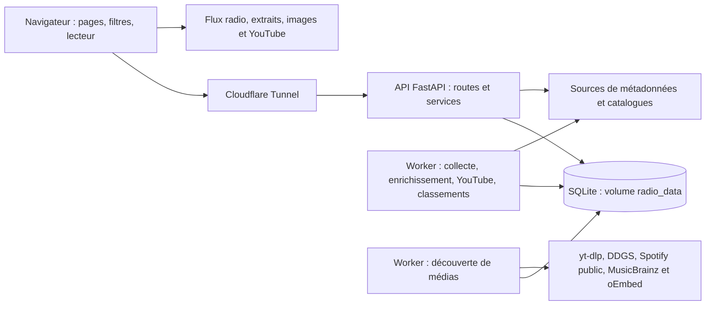

# Architecture — Radio Tracker

État actualisé le 10 novembre 2026, à partir du code et des fichiers cités.
Le [chantier de chargement et d’écoute](docs/prepared-loading-and-daily.md)
décrit la migration 0017 et les vérifications de cette évolution.
Le [PRD](PRD.md) porte le besoin produit ; ce document décrit sa réalisation
actuelle et les arbitrages encore ouverts. Les évolutions réalisées et les options non arbitrées restent distinctes.

## Lecture rapide

Radio Tracker permet de retrouver les titres diffusés et d’écouter les radios.
Jinja2 et JavaScript composent l’interface ; FastAPI sert pages et données ;
un worker collecte et enrichit les titres ; SQLite conserve passages et catalogue.
Les médias sont lus depuis les fournisseurs, directement par le navigateur.

Ce document décrit les composants (§1–2), les parcours (§3), les données (§4),
les caches (§5), les accès (§6) et l’exploitation (§7). Les arbitrages futurs (§8)
et les limites des mesures (§9) restent distincts de l’architecture existante.

## 1. Vue d’ensemble de l’existant

Le produit est un monolithe modulaire Python, exécuté dans trois processus
applicatifs : l’API web, le worker de collecte et le worker de découverte des médias.
Ils partagent la base, les modèles et les
services du même dépôt. Les fonctions de collecte, d’enrichissement, de
recherche YouTube et de préparation des classements sont des boucles du même processus worker, pas trois services
Docker indépendants. La découverte gratuite yt-dlp/DDGS, complétée par MusicBrainz/Cover Art Archive
utilise son propre conteneur, une file SQLite persistante et des appels bornés ;
elle ne bloque pas la collecte ni les requêtes publiques. Il n’existe pas de courtier de messages externe dans la
configuration de production versionnée.

Le schéma sépare le média de la métadonnée. L’API peut résoudre une URL d’extrait
ou rediriger une image ; le navigateur télécharge et décode les médias depuis
leurs fournisseurs. L’application n’est pas un relais audio.

## 2. Organisation du code

| Emplacement | Responsabilité actuelle |
| --- | --- |
| `app/main.py` | Assemblage FastAPI, pages HTML, routes publiques principales, version des assets |
| `app/*_api.py` | Routes de catalogue, statistiques, administration, exports, sélections et images |
| `app/templates/`, `app/static/`, `app/locales/` | Jinja2, JavaScript natif, styles, navigation persistante et traductions FR/EN |
| `app/worker.py` | Ordonnancement de collecte et lancement des boucles d’enrichissement et YouTube |
| `app/services/` | Collecte, fournisseurs, identité, exclusions, exploration, enrichissement et diagnostics |
| `app/models.py`, `app/database.py`, `migrations/` | Modèle relationnel, sessions SQLAlchemy et migrations Alembic |
| `config/stations.json`, `app/services/station_config.py` | Configuration versionnée des radios, validation et synchronisation sans effacer leurs passages |
| `scripts/` | Configuration, transferts, diagnostic, observation et déploiement |
| `tests/` | Tests Python, JavaScript et scénarios navigateur exécutables séparément |
| `.github/workflows/` | CI, publication/déploiement et diagnostic manuel Skyrock |

Le code possède déjà des modules métier. Les routes accèdent aussi directement à
SQLAlchemy et les services partagent les modèles : une séparation complète en
couches domaine/application/adaptateurs serait une évolution, pas l’état actuel.

## 3. Parcours techniques principaux

### Consultation

Une page Jinja fournit la structure et la configuration au navigateur. Les modules
JavaScript appellent les routes JSON avec leurs filtres. Les routes valident les
paramètres, interrogent les services/SQLAlchemy et attachent les métadonnées du
catalogue. La navigation interne conserve les éléments des lecteurs.

Les routes de consultation du classement, de l’historique et des statistiques
reposent sur les données locales. D’autres routes, notamment certaines opérations
de catalogue, de résolution d’extraits et de découverte d’images, peuvent contacter
un fournisseur. Il ne faut donc pas assimiler toute latence HTTP à du temps SQL.

Sources : [main](app/main.py), [exploration](app/services/explorer.py),
[statistiques](app/services/stats.py), [catalogue](app/catalog_api.py),
[images de station](app/artwork_api.py).

### Collecte et enregistrement

1. Le worker charge un instantané détaché des radios actives. Il ne garde pas de
   connexion SQL ouverte pendant la récupération réseau des métadonnées.
2. Les échéances persistées et la concurrence bornent les tentatives. Les valeurs
   par défaut du code sont 20 s entre départs, 12 s de timeout et trois collectes
   concurrentes ; elles ne constituent pas une mesure du délai réellement observé.
3. Les adaptateurs récupèrent ICY, JSON ou HTML. Les 18 Skyrock configurées utilisent
   le JSON groupé avec correspondance entre montage du flux et clé de radio.
4. L’enregistrement compare événement, dates et libellés à l’état durable de la
   station. Répétition d’une observation, réponse ancienne et vraie rediffusion
   sont distinguées selon les informations disponibles de la source.
5. La blacklist est vérifiée avant nouvelle insertion ; l’état de collecte peut
   progresser même lorsqu’un titre est exclu. Les anciens passages restent conservés.
6. Le catalogue et, si configurée, la recherche YouTube sont alimentés. Les états
   et événements techniques sont persistés indépendamment du contenu musical.

L’heure `detected_at` est celle de la détection. Le début d’événement source est
une information distincte lorsqu’elle existe. L’état garde jusqu’à 32 identités
récentes d’événements ; il ne garantit pas une déduplication illimitée de données
anciennes sans horaire source. L’identité musicale normalisée artiste/titre est
partagée avec le catalogue ; elle ne remplace pas l’identité d’une diffusion.

Sources : [worker](app/worker.py), [adaptateurs](app/services/metadata.py),
[Skyrock](app/services/skyrock.py), [enregistrement](app/services/collector.py),
[identité](app/services/track_identity.py), [ordonnancement](app/services/collection_schedule.py).

### Enrichissement, pochettes et écoute

Le catalogue conserve candidats, version choisie, paroles, provenance, état de
recherche et échéances. Les choix manuels restent distincts des compléments
automatiques. Les tentatives et quotas YouTube sont durables en base.

`temporary_cover_url` est indépendant de la pochette officielle sélectionnée.
Skyrock et myTuner servent de sources temporaires avec vérification de correspondance.
L’image de station (`/api/stations/{id}/artwork`) est un autre mécanisme : logo
connu ou image découverte sur le site configuré, avec redirection du navigateur.
Le repli de catalogue applique désormais un score artiste/titre/métadonnées,
avec refus des ambiguïtés et priorité à la pochette validée. Google n’est pas intégré ;
Spotify demeure un fournisseur optionnel serveur dont la disponibilité réelle
n’est pas établie par l’échantillon documenté.

Le lecteur maintient le flux radio sain connecté mais muet pendant pause, extrait
ou vidéo. Après erreur, fin ou connexion bloquée, il recharge le flux avec trois
réessais à 1/2/4 s ; un watchdog attend 12 s et le budget se réinitialise après
30 s stables. Une action manuelle reste possible après épuisement. Les timers
sont annulés lors de la pause et des changements de source ; le refus autoplay
ne provoque pas de boucle. Ce comportement ne résout pas un blocage réseau extérieur.

Sources : [catalogue](app/services/catalog.py), [YouTube](app/services/youtube.py),
[pochettes temporaires](app/services/temporary_artwork.py), [myTuner](app/services/mytuner.py),
[lecteur](app/static/player.js), [vidéos](app/static/youtube.js).

## 4. Base, données et conservation

### Modèle logique

| Tables | Rôle et lien principal |
| --- | --- |
| `stations` | Radios, configuration effective, préférence d’activation et état de collecte |
| `plays` | Plusieurs passages par station ; artiste/titre, identité musicale, détection, dernière observation, source et métadonnées brutes |
| `track_metadata` | Fiche enrichie par identité musicale ; sélection, candidats, paroles, genre et pochette temporaire |
| `global_exclusions` | Blacklist commune par couple artiste/titre normalisé |
| `play_counts` | Comptes horaires transactionnels par radio et libellés/identité |
| `ranking_counts`, `ranking_states` | Générations préparées des classements, date et révision de visibilité |
| `admin_sessions` | Sessions administratives, expiration et protection CSRF |
| `youtube_matches`, `service_quotas` | Recherche/choix vidéo, délais, réservation de travail et budget fournisseur |
| `worker_states`, `worker_events` | État et activité bornée des boucles de fond |
| `collection_status`, `collection_events` | État par station et journal technique des tentatives, sans libellés musicaux |

`plays.station_id` est une clé étrangère. `plays.track_id` est une identité musicale
indexée, sans clé étrangère déclarée vers `track_metadata` ; il ne faut pas supposer
une intégrité référentielle que le modèle n’impose pas.

Le catalogue est enrichissable et les diffusions restent des faits séparés.
Les métadonnées brutes de certaines sources peuvent contenir des payloads : elles
sont privées. L’adaptateur Skyrock réduit son enregistrement brut au début et à
l’UID, sans profils utilisateurs. Les diagnostics techniques ne doivent pas publier
les payloads ni les secrets.

### Stockage et accès

La configuration de production du dépôt utilise un fichier SQLite dans le volume
`radio_data`, partagé par API et worker. Chaque processus crée son moteur SQLAlchemy :
pool de deux connexions, sans débordement, attente de pool 5 s. SQLite est configuré
avec WAL, clés étrangères actives, `synchronous=NORMAL`, délai de verrouillage
5 s et cache configuré à environ 2 Mio par connexion.

Les index portent notamment sur station/date, date, identité, identité/station/date
et des combinaisons couvrantes pour les classements/périodes SQLite. Leur présence
ne prouve pas qu’un plan les utilise ni qu’une requête est rapide.

Le code contient des branches SQL et une dépendance optionnelle PostgreSQL ; le
Compose de production décrit SQLite. Une migration PostgreSQL et une validation
équivalente sur ce moteur ne sont pas établies par cette compatibilité partielle.

### Index du catalogue administratif

La migration [0016](migrations/versions/0016_catalog_review_cover.py) ajoute
l’index couvrant SQLite `ix_track_metadata_review_cover` sur artiste, titre,
statut, statut des paroles et identité, puis exécute `ANALYZE` sur cet index.
Les compteurs du catalogue du tableau admin utilisent une agrégation commune,
sans nouveau cache et en conservant les exclusions.

### Conservation et restauration

Le paramètre `retention_days` vaut 180 par défaut, avec désactivation possible à 0.
La maintenance du worker archive les anciens passages dans des fichiers JSONL gzip
avant de supprimer les lots correspondants de la base active. Le travail est borné
et l’archive est rendue durable avant le commit SQL. Ce mécanisme est indépendant
du masquage : aucune exclusion ne déclenche cette suppression.

Les requêtes de consultation lisent la base active ; elles ne relisent pas
automatiquement les archives gzip. Le volume local partagé ne constitue pas à lui
seul une sauvegarde indépendante de la machine. Le déploiement exporte les données
avant migration ; fréquence hors déploiement, copie externe et délai de restauration
ne doivent pas être supposés garantis.

Sources : [modèles](app/models.py), [base](app/database.py), [migrations](migrations),
[maintenance](app/services/maintenance.py), [transfert](scripts/transfer.py),
[déploiement](scripts/deploy.sh), [configuration](app/config.py).

## 5. Caches et cohérence

| Cache existant | Portée | Limite et expiration dans le code |
| --- | --- | --- |
| Classements courants préparés | SQLite, partagés entre API et worker | Générations persistantes, cadence de 30 s ; heure et révision d’exclusions vérifiées |
| Classement particulier `cached_top` | Mémoire du processus API | 64 entrées ; 30 s par défaut, paramétrables |
| Statistiques détaillées | Mémoire du processus API | 64 entrées ; 30 s |
| Exploration | Mémoire du processus API | 32 entrées ; 3 s |
| Réponses navigateur `RadioCache` | Onglet : mémoire et `sessionStorage` si disponible | 40 entrées ; 5 min ; préfixe par version d’assets |
| Schedule Skyrock | Client HTTP du worker, partagé avec les pochettes | 15 s, verrou des appels concurrents, fraîcheur et fin d’événement revérifiées ; erreurs/Retry-After mutualisés |
| Découverte d’image de station | Mémoire API, par site, sous verrou asynchrone commun | 128 entrées ; succès 24 h, absence 15 min ; redirection HTTP avec durée distincte |

Les clés des caches de résultats concernés comprennent les filtres et la révision
de blacklist globale. Le navigateur transmet ses exclusions personnelles et
invalide ses résultats lors des changements. Les caches mémoire ne sont pas
partagés entre processus et disparaissent au redémarrage. Aucun Redis ou cache
distribué n’est configuré. Le TTL navigateur n’implique pas que toutes les routes
soient mises en cache pendant cinq minutes : chaque module décide de son usage.

**Constat de code :** le verrou du cache de classement ne couvre plus le calcul SQL ;
la découverte d’images tient encore un verrou commun pendant la requête distante.
**Hypothèse à mesurer :** des requêtes concurrentes pourraient attendre ces
sections. Leur contribution aux lenteurs signalées n’a pas été mesurée ici.
Les timestamps exacts appartiennent à la clé du classement ; un cache chaud sur
une requête ne garantit pas un cache chaud pour une autre période.

Sources : [classements](app/services/stats.py), [statistiques](app/metrics_api.py),
[exploration](app/services/explorer.py), [cache navigateur](app/static/cache.js),
[filtres](app/static/filters.js), [Skyrock](app/services/skyrock.py),
[images](app/artwork_api.py).

## 6. Exclusions, accès et dépendances

Les exclusions globales sont persistées ; les exclusions personnelles sont des
préférences de navigateur, transmises aux requêtes concernées. Les conditions SQL
communes les appliquent avant agrégation et pagination. Les identités et variantes
nécessitent aussi les contrôles spécifiques des services. Une future optimisation
ne doit pas servir un résultat calculé pour un autre périmètre de visibilité.

Les pages administratives et leurs API utilisent des sessions avec cookie sécurisé,
expiration, protection CSRF et contrôle d’origine. Les clients serveur peuvent
utiliser le mécanisme Bearer compatible. Il n’y a pas de gestion de comptes publics.
Les secrets sont fournis par la configuration privée et les secrets de CI.

Le transport de collecte valide les destinations publiques et fixe la connexion
sur l’IP vérifiée pour limiter le risque de rebinding DNS. Taille, durée, concurrence
et tentatives sont bornées. Les catalogues d’enrichissement utilisent aussi leurs
propres clients HTTP : ne pas extrapoler le transport de collecte à tous les appels.
La disponibilité, les quotas, les images, les extraits et les règles des intégrations
restent dépendants de services externes.

Sources : [exclusions](app/services/exclusions.py), [sessions](app/admin_sessions.py),
[middleware](app/security.py), [réseau](app/services/network.py).

## 7. Exploitation et vérification

La production versionnée exécute une API Uvicorn à un worker, un conteneur de
collecte et Cloudflare Tunnel. Les limites Compose sont 160 Mio/0,5 CPU pour l’API
et 128 Mio/0,5 CPU pour le worker de collecte ; le worker de découverte dispose
de 256 Mio/0,25 CPU. Le système de fichiers des conteneurs applicatifs
est en lecture seule hors volume et tmpfs ; ils s’exécutent sans privilèges root.
Ces limites décrivent la configuration, pas des mesures de consommation ou de capacité.

La CI vérifie Python, Ruff, syntaxe et tests JavaScript, shell, configuration,
dépendances, migrations SQLite et image Docker avec smoke tests. Les scénarios
navigateur sont des scripts séparés ; ils ne sont pas tous lancés automatiquement
par la CI générale. Le workflow manuel Skyrock ajoute des sondes du worker et un
contrôle de lecture Chrome sur le site public.

Un push sur `master` déclenche la CI puis, si elle réussit, publication d’image et
déploiement SSH de la révision vérifiée. Une sauvegarde précède migration et
synchronisation des radios. La CD vérifie la santé, les diagnostics et observe la
collecte pendant six minutes. Elle peut réussir tout en rapportant des erreurs
fournisseur : santé du service, activité du worker et qualité des observations
restent trois résultats distincts. Aucun rollback automatique de base n’est annoncé.

Sources : [Dockerfile](Dockerfile), [Compose de production](compose.production.yaml),
[CI](.github/workflows/ci.yml), [CD](.github/workflows/cd.yml),
[diagnostic Skyrock](.github/workflows/skyrock-diagnostics.yml),
[contrôle de collecte](scripts/check_collection_diagnostics.py),
[observation](scripts/observe_collection.py).

## 8. Registre des arbitrages

**Décision acquise D01 :** priorité à l’usage personnel, retrouver des titres et
écouter les radios, confirmée par le product owner le 9 novembre 2026. Cela oriente
l’ordre de travail ; cela n’approuve pas une technologie future.

| Décision | Options à comparer, sans choix imposé | Conséquences possibles sur le code | Preuve nécessaire et état |
| --- | --- | --- | --- |
| D02 — Réactivité des parcours | Titres courants et commandes utilisables en 2 s, statistiques/pochettes ensuite | Bundle différé, montage public indépendant de la session admin, lecture ciblée | Objectif confirmé ; mesures après livraison requises |
| D03 — Fraîcheur | Vues courantes préparées, retard accepté de 1 min, date visible et réessais | Compteurs et générations, exclusions avant calcul public ; conserver le dernier résultat compatible en erreur | Arbitrage confirmé ; fenêtre réelle de fraîcheur à mesurer après livraison |
| D04 — Historique et reprise | Historique plus long en base, archives restaurables à la demande, politique actuelle | Maintenance, stockage, restauration et éventuellement accès aux archives ; distinguer archivage et masquage | Période utile, volume, perte/délai de restauration acceptables ; à décider |
| D05a — Stockage | Conserver SQLite avec optimisations ciblées ou étudier PostgreSQL | URL/driver, migrations, SQL spécifique, transactions, tests et exploitation ; aucune bascule sans comparaison | Plans, volumes, attente de verrous/pool et charge concurrente ; aucune cause établie |
| D05b — Structure du code | Conserver les modules actuels ou renforcer progressivement les frontières routes/services/accès SQL | Déplacer le code par responsabilité et stabiliser des interfaces ; préserver contrats et tests | Difficultés concrètes de maintenance et bénéfice attendu ; à décider avant restructuration |
| D05c — Travail de fond | Conserver les boucles actuelles ou isoler un traitement si nécessaire | Processus, coordination, état durable, déploiement et éventuellement file de travail | Saturation ou besoin d’indépendance démontré ; aucune file externe ni extraction de service approuvée |

Gabarit de décision à utiliser en revue : **ID, besoin, options, preuves, choix du
product owner, justification, date, périmètre, conséquences, validation et retour
arrière**. Les propositions restent ouvertes jusqu’à confirmation explicite.

## 9. Inconnues et frontière du prochain chantier

Les premières mesures et leurs limites figurent dans le
[rapport de chargement](docs/performance-loading.md). Après l’index du catalogue,
le tableau admin a répondu en 180 puis 195 ms en HTTP sur les échantillons
rapportés, atteignant l’objectif confirmé de moins de 2 s. Ce résultat ne garantit
pas la latence générale : un premier classement HTTP a encore pris 12 s.
Le premier diagnostic a conduit aux optimisations décrites dans le rapport historique. Le chantier du 10 novembre ajoute la préparation et le bundle ; ses mesures après livraison restent distinctes.

Le [middleware de profilage](app/loading_profile.py) mesure le temps API jusqu’au
départ des en-têtes, la durée cumulée et maximale des exécutions SQL et leur
nombre. Il exige une demande explicite et un Bearer administrateur ; il couvre
uniquement classement, titres courants et tableau admin. Aucun SQL ni paramètre
n’est publié. Le téléchargement complet, le rendu navigateur et tous les coûts
de récupération des lignes ne sont pas mesurés par ces compteurs.

Ces observations ne démontrent ni la nécessité de PostgreSQL ni une cause unique
aux lenteurs. Les prochaines comparaisons doivent préserver les exclusions et
séparer SQL, API, réseau et navigateur. SQLite utilise `EXPLAIN QUERY PLAN` ;
le `EXPLAIN ANALYZE` de PostgreSQL ne lui est pas directement applicable.

## 10. Évolution du 10 novembre : préparation et lecture

La migration 0017 ajoute `play_counts`, `ranking_counts` et `ranking_states`.
Des triggers SQLite maintiennent les comptes horaires lors des écritures ; ils
couvrent aussi imports, corrections et archivage. Le préparateur lit un instantané,
écrit une génération par petits lots et publie atomiquement les quatre périodes.
Il dispose de connexions distinctes de la collecte ; aucun Redis ni service externe
n’est ajouté. Le lecteur vérifie la révision globale et applique les exclusions
personnelles et globales avant agrégation/limite. Les vues courantes ne dépendent
plus du cache mémoire de l’API. Les fenêtres particulières restent à la demande.

Le navigateur charge un bundle ordonné et différé. La session administrateur et la vérification de révision ne
bloquent plus les lectures publiques fraîches, filtrées côté serveur. Les caches
navigateur restent gardés par la révision connue. Les genres ne sont plus lus sur l’accueil.
L’API expose l’heure de calcul et les bornes, utilisées aussi par les détails et
exports ; le navigateur préserve un classement daté lors d’un échec d’actualisation.

La daily réutilise les vidéos stockées et revalide la visibilité avant chaque
lecture. L’association administrative d’une URL utilise oEmbed avec domaines et
identité vérifiés ; elle n’utilise pas de recherche Data API. Les réglages sont
locaux au navigateur : autoplay, fondu des extraits et visibilité CSS de la vidéo.

D02 et D03 sont précisés dans le PRD d’après les arbitrages confirmés. D05 conserve
SQLite et les processus existants avec compteurs et vues préparées ; la demande
actuelle autorise cette réalisation avant k6. Les autres options non arbitrées ne
sont pas réputées approuvées. Les mesures et limites finales figurent dans le
[rapport du chantier](docs/prepared-loading-and-daily.md).
