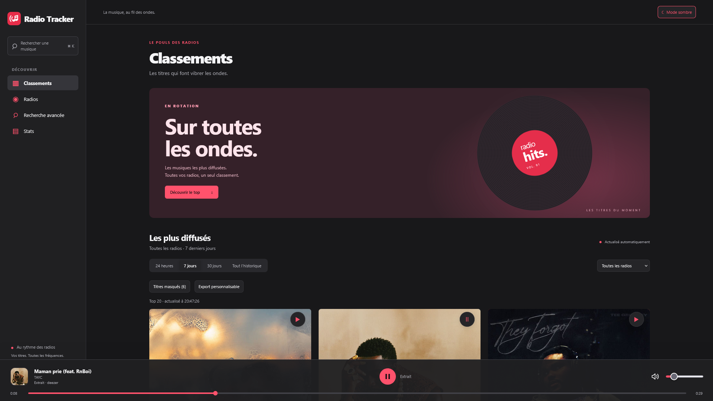
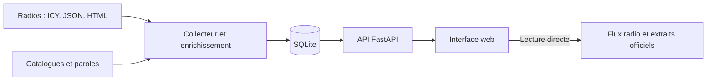

<p align="center">
  
</p>

<h1 align="center">Radio Tracker</h1>

<p align="center">La musique, au fil des ondes.<br>Suivez les titres diffusés, explorez votre catalogue et écoutez vos radios.</p>

<p align="center">
  <a href="https://github.com/Hicha-m/track-radio/actions/workflows/ci.yml"></a>
  <a href="https://github.com/Hicha-m/track-radio/actions/workflows/cd.yml"></a>
  
  
  
  
</p>



Radio Tracker collecte les **métadonnées** des radios et conserve leurs passages pour proposer classements, recherches et statistiques. L’écoute utilise directement les flux officiels et les extraits des fournisseurs : le serveur ne stocke et ne redistribue aucun audio.

[Découvrir les fonctions](#fonctionnalités) · [Démarrer](#démarrage-rapide) · [Configurer](#configuration) · [Tester](#développement-et-tests) · [Guide technique](docs/guide-technique.md)

## Fonctionnalités

| Espace | Ce que vous pouvez faire |
| --- | --- |
| **Classements** | Explorer les titres les plus diffusés par radio et par période, avec pochettes et extraits. |
| **Recherche** | Filtrer l’historique par titre, artiste, station, dates et fréquence ; retrouver un morceau avec la recherche rapide. |
| **Fiche musicale** | Consulter la version choisie, les métadonnées, les paroles, la provenance des informations et les derniers passages. |
| **Statistiques** | Comparer répétitions, diversité, genres, recoupements et décalages entre radios. |
| **Export** | Choisir périmètre, filtres, nombre de résultats et champs ; télécharger en CSV ou JSON. |
| **Administration** | Piloter les radios, vérifier le catalogue et prévisualiser les corrections de diffusions dans des pages dédiées. |

L’interface s’adapte au mobile et à l’ordinateur, en **clair ou sombre**. Le même lecteur sert au direct et aux extraits ; la navigation interne conserve la lecture.

### Un catalogue enrichi sans perdre vos choix

La recherche initiale combine Deezer et iTunes, avec LRCLIB pour les paroles. Les recherches administratives donnent aussi accès à MusicBrainz, Cover Art Archive, Spotify, Last.fm et lyrics.ovh, selon la source et sa configuration.

Après **Choisir cette version**, l’action **Relancer la recherche automatique** cherche les compléments chez les autres catalogues disponibles, même si un genre est déjà présent. Elle conserve la version, les champs renseignés et les paroles choisies. Les ajouts sont limités à des résultats compatibles et conservent leur provenance ; une ambiguïté ne provoque pas de choix arbitraire. Le traitement se fait en arrière-plan et les erreurs temporaires sont réessayées.

Les exclusions personnelles de l’appareil s’ajoutent à la blacklist globale avant les résultats et calculs concernés, y compris en mode admin. La blacklist bloque les nouveaux passages sans supprimer l’historique conservé.

## Démarrage rapide

**Prérequis :** Docker et Docker Compose. Pour un site public, prévoir HTTPS avant d’utiliser l’administration.

```bash
git clone https://github.com/Hicha-m/track-radio.git
cd track-radio
cp .env.example .env
```

Pour activer l’administration, générez une clé puis renseignez `ADMIN_TOKEN` dans le `.env` privé :

```bash
python -c "import secrets; print(secrets.token_urlsafe(32))"
```

Démarrez l’API et le collecteur :

```bash
docker compose up --build -d --wait
docker compose ps
```

Ouvrez **http://127.0.0.1:8080**. Les données persistent dans le volume `radio_data` ; `docker compose down` les conserve.

### Navigation

| Adresse | Usage |
| --- | --- |
| `/` | Classements et écoute des radios |
| `/recherche` | Recherche avancée et historique |
| `/stats` | Statistiques musicales |
| `/admin` | Connexion administrateur |
| `/admin/dashboard` | Vue d’ensemble administrative |
| `/admin/radios` · `/admin/diffusions` | Collecte et gestion des passages |
| `/admin/catalogue` · `/admin/exclusions` | Versions, métadonnées et masquages |
| `/docs` | Documentation interactive de l’API |

Une connexion depuis une sous-page admin revient à la destination demandée. La session utilise un cookie sécurisé ; la clé n’est pas stockée dans le navigateur.

## Configuration

Le fichier [.env.example](.env.example) décrit les variables disponibles. Conservez les valeurs réelles dans votre environnement privé.

| Variable | Rôle | Valeur par défaut |
| --- | --- | --- |
| `PORT` · `BIND_ADDRESS` | Port et interface du serveur Docker local | `8080` · `127.0.0.1` |
| `ADMIN_TOKEN` | Clé de connexion admin ; vide pour désactiver la connexion | vide |
| `ADMIN_SESSION_HOURS` | Durée maximale d’une session admin | `8` |
| `POLL_INTERVAL_SECONDS` | Intervalle de collecte | `20` |
| `COLLECTOR_CONCURRENCY` | Collectes simultanées | `3` |
| `RETENTION_DAYS` | Période conservée avant archivage | `180` |
| `SPOTIFY_CLIENT_ID` · `SPOTIFY_CLIENT_SECRET` | Accès serveur au catalogue Spotify | facultatifs |
| `LASTFM_API_KEY` | Recherche Last.fm | facultative |

Les radios sont décrites dans [config/stations.json](config/stations.json). Les sources **ICY, JSON et HTML** sont prises en charge ; les préférences de collecte se pilotent depuis l’administration. Les fournisseurs à identifiants ne sont interrogés automatiquement que lorsqu’ils sont configurés.

## Architecture



- **API :** FastAPI, SQLAlchemy, Jinja2 et JavaScript natif.
- **Collecteur :** collecte périodique et enrichissement progressif, avec reprises sur erreurs temporaires.
- **Stockage :** SQLite par défaut, migrations Alembic, exports/imports de sauvegarde ; migration depuis PostgreSQL documentée.
- **Exploitation :** services Docker séparés, limites de ressources et contrôles de santé.

Le déploiement par défaut vise une petite machine pour un usage personnel et quelques visiteurs. Les plafonds de 160 Mio pour l’API et 128 Mio pour le collecteur sont des limites de conteneurs, pas une mesure de consommation ni une garantie de capacité.

## Développement et tests

Python **3.12 ou supérieur** est requis. Après création et activation d’un environnement virtuel :

```bash
pip install --require-hashes -r requirements-dev.lock
pip install --no-deps -e .
mkdir -p data
alembic upgrade head
python scripts/seed.py
uvicorn app.main:app --reload --port 8080
# Dans un second terminal, avec le même environnement :
python -m app.worker
```

Contrôles locaux :

```bash
python -m pytest
ruff check .
ruff format --check .
for script in app/static/*.js; do node --check "$script"; done
node --test tests/*.test.cjs
```

Les parcours navigateur utilisent Playwright, une base temporaire et des fournisseurs simulés :

```bash
pip install playwright
python -m playwright install chromium
PYTHONPATH=. python tests/browser_check.py
PYTHONPATH=. python tests/browser_admin_layout.py
PYTHONPATH=. python tests/browser_candidate_actions.py
```

Ils couvrent notamment la navigation sans interruption du lecteur, les formats mobiles, les sessions admin et le choix/complément des versions. Les scénarios ciblés d’export, d’exclusions et de corrections sont décrits dans le guide.

## Déploiement et exploitation

Les pushes sur `master` déclenchent la **CI** : tests Python et JavaScript, Ruff, audit des dépendances, migrations et vérification de démarrage Docker. Après succès, la **CD** publie l’image sur GHCR et déploie la version validée sur le serveur configuré, avec sauvegarde préalable et contrôles de santé.

- [Workflows CI/CD](.github/workflows) : configuration des contrôles et du déploiement.
- [`GET /health`](docs/guide-technique.md#santé-des-conteneurs) : santé de l’API ; `/api/version` expose la révision et l’empreinte des assets.
- [Guide technique](docs/guide-technique.md) : HTTPS, variables serveur, sauvegardes, restauration, API et gestion des radios.

Les identifiants restent hors du dépôt et de l’image. Les données persistantes doivent être sauvegardées avant toute restauration ou modification de stockage.
